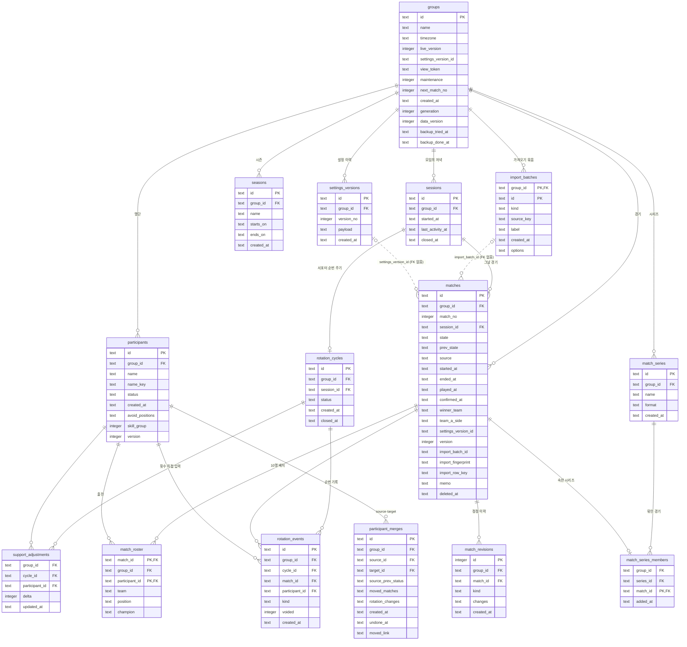

# DB 구조도 (D1)

`migrations/`의 마이그레이션(0001~0029, 0004는 없음)을 차례로 적용한 최종 스키마를 그린 것이다. 표 35개 중 모임 자료를 담는 28개를 두 그림으로 나눴다.
스키마를 바꾸는 마이그레이션을 더하면 이 문서도 다시 만든다. 손으로 고치지 말고 아래 "다시 만드는 법"을 따른다.

읽는 법
- 실선은 마이그레이션에 적힌 외래 키다. 점선은 코드가 ID로 잇지만 외래 키는 없는 참조다(지워진 참가자·경기를 가리킬 수 있다).
- 거의 모든 외래 키는 `(group_id, id)` 복합 키다. 다른 모임의 행을 가리키지 못하게 하려는 것이라, 그림에는 한 줄로만 그렸다.
- PK가 둘 이상인 표는 복합 기본 키다(예: `match_roster`는 경기·참가자).

## 1. 경기 기록

모임 → 저녁(sessions) → 경기(matches) → 10명 배치(match_roster)가 뼈대다. 서포터 순번(rotation_*)은 저녁마다 주기가 하나씩 있다.

## 2. 계정·권한·링크

운영자 권한은 `group_operators`(대표 1명)와 `group_co_operators`(공동)로 나뉜다. 참가자 본인 연결(`participant_links`)은 운영자 권한과 따로 멤버 경로만 연다(src/server/auth.ts).
링크 표(넘기기·초대·연결·참가 신청)는 토큰 원문 대신 SHA-256(`token_hash`)만 둔다. 예외로 `join_links.token`은 운영자 화면에 링크를 다시 보여 주려고 원문도 둔다(migrations/0015).

```mermaid
erDiagram
  accounts {
    text id PK
    text provider
    text subject
    text created_at
    integer session_epoch
  }
  local_credentials {
    text account_id PK, FK
    text password_hash
    text recovery_hash
    text updated_at
  }
  group_operators {
    text group_id PK, FK
    text account_id FK
    text created_at
  }
  group_co_operators {
    text group_id PK, FK
    text account_id PK, FK
    text created_at
  }
  operator_transfers {
    text token_hash PK
    text group_id FK
    text created_at
    text expires_at
    text used_at
  }
  co_operator_invites {
    text token_hash PK
    text group_id FK
    text created_at
    text expires_at
    text used_at
  }
  participant_links {
    text group_id PK, FK
    text participant_id PK
    text account_id FK
    text created_at
    text avoid_self_at
  }
  participant_claims {
    text token_hash PK
    text group_id FK
    text participant_id
    text created_at
    text expires_at
    text used_at
  }
  participant_requests {
    text id PK
    text group_id FK
    text participant_id
    text kind
    text match_id
    text body
    text status
    text reply
    text created_at
    text resolved_at
  }
  join_links {
    text group_id PK, FK
    text token_hash
    integer is_open
    text created_at
    text updated_at
    text token
  }
  join_requests {
    text id PK
    text group_id FK
    text participant_id FK
    text new_name
    text name_key
    text created_at
    text account_id
  }
  draft_handoffs {
    text group_id PK, FK
    text handoff_id
    text body
    integer base_live_version
    integer people
    text created_at
  }
  restore_jobs {
    text group_id PK, FK
    text started_at
    text request_id
    text run_token
    integer heartbeat_ms
  }
  groups {
    text id
  }
  participants {
    text id
  }

  accounts ||--o| local_credentials : "자체 계정 비밀번호"
  groups ||--|| group_operators : "대표 운영자 1명"
  accounts ||--o{ group_operators : ""
  groups ||--o{ group_co_operators : "공동 운영자"
  accounts ||--o{ group_co_operators : ""
  groups ||--o{ operator_transfers : "넘기기 링크"
  groups ||--o{ co_operator_invites : "공동 운영자 초대 링크"
  groups ||--o{ participant_links : "참가자 본인 연결"
  accounts ||--o{ participant_links : ""
  participants |o..o| participant_links : "participant_id (FK 없음)"
  groups ||--o{ participant_claims : "연결 링크"
  participants |o..o{ participant_claims : "participant_id (FK 없음)"
  groups ||--o{ participant_requests : "멤버 요청"
  participants |o..o{ participant_requests : "participant_id (FK 없음)"
  groups ||--o| join_links : "참가 신청 링크"
  groups ||--o{ join_requests : "참가 신청"
  participants |o--o{ join_requests : "기존 참가자로 신청"
  accounts |o..o{ join_requests : "account_id (FK 없음)"
  groups ||--o| draft_handoffs : "넘긴 편성"
  groups ||--o| restore_jobs : "복원 잠금"
```

## 그림에 넣지 않은 표

모임 자료와 관계가 없는 운영용 표다.

| 표 | 쓰임 |
| --- | --- |
| `requests` | 같은 요청 ID를 한 번만 처리하는 기록(src/server/mutation.ts runMutation). `(group_id, request_id)` |
| `guard` | batch 안에서 조건이 깨지면 일부러 실패시키는 보호 문장용 빈 표(CHECK 제약으로 막힘) |
| `rate_limits`, `rate_limit_hits` | 요청 수 제한 창과 하루 집계(src/server/ratelimit.ts) |
| `auth_failures` | 자체 계정 틀린 시도 횟수(src/server/local.ts) |
| `error_logs` | 화면·서버 오류 기록(가린 값만, src/server/errorLog.ts) |
| `feedback` | 로그인 없이 받는 피드백(src/server/feedback.ts) |

## 다시 만드는 법

Node 22 이상의 내장 `node:sqlite`로 마이그레이션을 메모리 DB에 적용한 뒤 `PRAGMA table_info`·`foreign_key_list`·`index_list`로 읽었다(2026-11-27).
관계 이름과 점선(FK 없는 참조)은 사람이 코드를 보고 붙인 것이니, 새 표가 생기면 그 표의 ID 열이 어디를 가리키는지 코드에서 확인해 더한다.
